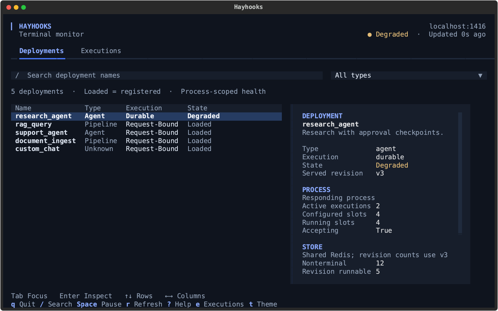
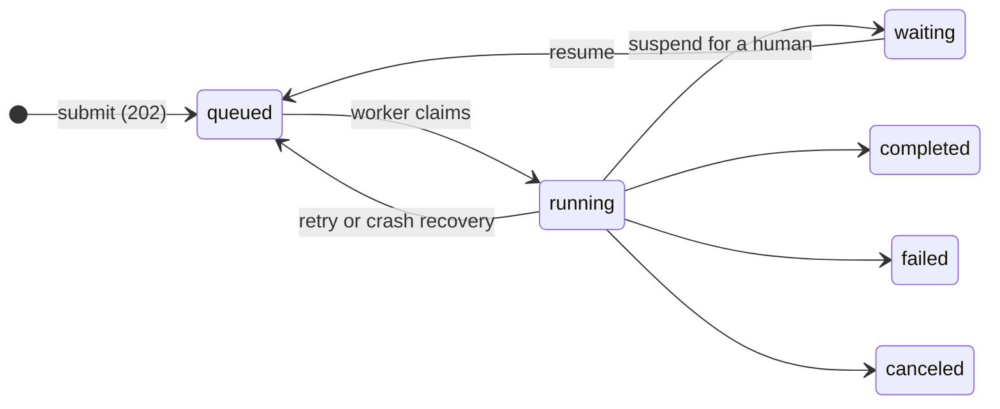

<div align="center">


# Hayhooks

**Serve [Haystack](https://haystack.deepset.ai/) pipelines and agents as APIs.**

REST APIs, OpenAI-compatible chat, MCP tools, and A2A agents, with durable execution and built-in tracing.

[](https://pypi.org/project/hayhooks)
[](https://pypi.org/project/hayhooks)
[](https://github.com/deepset-ai/hayhooks/actions/workflows/docker.yml)
[](https://github.com/deepset-ai/hayhooks/actions/workflows/tests.yml)

[**Documentation**](https://deepset-ai.github.io/hayhooks/) · [Quick start](#quick-start) · [Dashboard](#terminal-dashboard) · [Durable execution](#durable-execution)

</div>

## Serve your pipelines and agents

Write a Python wrapper around your pipeline or agent. Choose the interfaces and runtime features you need:

- **REST APIs.** Deploy Python wrappers or YAML pipelines as typed, validated endpoints with OpenAPI docs, file uploads, and custom routes.
- **[OpenAI-compatible APIs](docs/features/openai-compatibility.md).** Serve streaming Chat Completions and Responses endpoints. Connect [Open WebUI](docs/features/openwebui-integration.md) or use the embedded [Chainlit UI](docs/features/chainlit-integration.md).
- **[MCP support](docs/features/mcp-support.md).** Run an MCP server that exposes pipelines and agents as tools for Cursor, Claude Desktop, and other Model Context Protocol clients.
- **[A2A support](docs/features/a2a-support.md).** Expose chat-capable pipelines and agents through the Agent2Agent protocol, with generated agent cards for discovery and task delegation.
- **[Durable execution](#durable-execution).** Checkpoint long-running work in Redis, wait for human approval, retry failures, and recover after restarts.
- **[Tracing and observability](docs/reference/tracing.md).** Inspect executions and component traces in the terminal dashboard, or export spans to an OpenTelemetry backend with `hayhooks[tracing]`.

## Terminal dashboard

Inspect deployments, follow executions, and find slow components in your terminal.

[](docs/assets/terminal-dashboard/overview-120x36.png)

*Actual terminal UI with demo data.* [Explore the dashboard](docs/features/terminal-dashboard.md).

## Quick start

Serve a Haystack agent through a typed HTTP endpoint. You need Python 3.10 through 3.14 and an OpenAI API key.

### Install and start

In your Python environment, install Hayhooks and set the API key before starting the server:

```bash
pip install hayhooks
export OPENAI_API_KEY="your-api-key"
hayhooks run
```

Leave the server running. Use a second terminal for the following commands.

### Create an agent

Create a directory named `my_agent_dir` and save this as `my_agent_dir/pipeline_wrapper.py`:

```python
from haystack.components.agents import Agent
from haystack.components.generators.chat import OpenAIResponsesChatGenerator
from haystack.dataclasses import ChatMessage
from haystack.tools import tool

from hayhooks import BasePipelineWrapper


@tool
def search(query: str) -> str:
    """Search the knowledge base."""
    return f"This is a demo tool."


class PipelineWrapper(BasePipelineWrapper):
    def setup(self) -> None:
        self.pipeline = Agent(
            chat_generator=OpenAIResponsesChatGenerator(model="gpt-4o-mini"),
            tools=[search],
        )

    async def run_api_async(self, question: str) -> str:
        result = await self.pipeline.run_async(messages=[ChatMessage.from_user(question)])
        return result["last_message"].text
```

Hayhooks uses the method's type hints to validate requests and generate the API schema.

### Deploy and run

```bash
hayhooks pipeline deploy-files -n my_agent ./my_agent_dir
curl http://localhost:1416/my_agent/run \
  -H 'Content-Type: application/json' \
  -d '{"question": "What can you do?"}'
```

The response contains the agent's answer. Open [the API docs](http://localhost:1416/docs) to inspect and try the endpoint.

<details>
<summary><strong>Add streaming chat</strong></summary>

Implement `run_chat_completion_async` to expose the agent through the [OpenAI-compatible Chat Completions API](docs/features/openai-compatibility.md#async-chat-completion-with-streaming).

Add these imports at the top of `pipeline_wrapper.py`:

```python
from collections.abc import AsyncGenerator
from hayhooks import async_streaming_generator
```

Add this method inside `PipelineWrapper`:

```python
    async def run_chat_completion_async(
        self, model: str, messages: list[dict], body: dict
    ) -> AsyncGenerator[str, None]:
        return async_streaming_generator(
            pipeline=self.pipeline,
            pipeline_run_args={
                "messages": [ChatMessage.from_openai_dict_format(m) for m in messages],
            },
        )
```

Redeploy the wrapper, then request a streamed response:

```bash
hayhooks pipeline deploy-files -n my_agent ./my_agent_dir --overwrite
curl -N http://localhost:1416/chat/completions \
  -H 'Content-Type: application/json' \
  -d '{
    "model": "my_agent",
    "messages": [{"role": "user", "content": "What can you do?"}],
    "stream": true
  }'
```

The response arrives as server-sent events. Connect [Open WebUI](docs/features/openwebui-integration.md) or use the [embedded Chainlit UI](docs/features/chainlit-integration.md) to chat with the agent.

</details>

<details>
<summary><strong>Inspect your run in the dashboard</strong></summary>

On macOS or Linux, open the dashboard in the second terminal under the same OS account as the server:

```bash
pip install "hayhooks[tui]"
hayhooks dashboard
```

Press `e` for executions or `v` for traces, then Enter for details. Local capture is enabled by default. Recent ordinary runs remain available until the server restarts or the buffer evicts them.

For Windows or remote access, follow the [dashboard connection guide](docs/features/terminal-dashboard.md#connect-to-a-remote-server). To export spans to an external OpenTelemetry backend, see [tracing and OpenTelemetry](docs/reference/tracing.md).

</details>

## Durable execution

Run work beyond the lifetime of a request. Hayhooks checkpoints pipelines and agents in Redis so another worker can resume after a restart.

Suspend a run for human approval, retry failures, or reconnect to its output stream from any replica.



<details>
<summary><strong>Run an agent with human approval</strong></summary>

This example waits for approval before calling a demo search tool. Save the wrapper as `pipelines/research_agent/pipeline_wrapper.py`.

```python
from haystack.components.agents import Agent
from haystack.components.generators.chat import OpenAIResponsesChatGenerator
from haystack.dataclasses import ChatMessage
from haystack.tools import tool
from pydantic import BaseModel

from hayhooks import BasePipelineWrapper, DurableContext


@tool
def search(query: str) -> str:
    """Search the knowledge base."""
    return f"Hayhooks serves Haystack pipelines and agents; results for {query!r}."


class Task(BaseModel):
    question: str


class Approval(BaseModel):
    approved: bool


class Report(BaseModel):
    answer: str


class PipelineWrapper(BasePipelineWrapper):
    durable_revision = "research-agent-v1"  # compatibility key for persisted inputs and checkpoints
    durable_resume_model = Approval  # typed input for human-in-the-loop waits

    def setup(self) -> None:
        generator = OpenAIResponsesChatGenerator(model="gpt-4o-mini")
        self.pipeline = Agent(chat_generator=generator, tools=[search])

    async def run_durable_async(self, context: DurableContext, task: Task) -> Report:
        # Persist the wait in Redis so a worker serving this revision can resume it.
        if not context.state.get("approved"):
            decision = context.resume_input  # consumed on first read
            if decision is None:
                await context.suspend({"kind": "approval", "message": f"Research {task.question!r}?"})
            if not Approval.model_validate(decision).approved:
                raise ValueError("research was rejected")
            context.state["approved"] = True

        # Agent state is checkpointed after tool calls: recovery continues the loop.
        result = await context.run_agent_async(messages=[ChatMessage.from_user(task.question)])
        return Report(answer=result["last_message"].text)
```

Stop the quick-start server if it is still running. Install the extra, start Redis, and serve the pipelines directory in durable mode:

```bash
pip install "hayhooks[durable]"
docker run -d -p 6379:6379 redis
export OPENAI_API_KEY="your-api-key"
HAYHOOKS_DURABLE_MODE=true hayhooks run --pipelines-dir ./pipelines
```

In a second terminal, submit the run:

```bash
curl -i http://localhost:1416/research_agent/run-durable \
  -H 'Content-Type: application/json' -d '{"question": "What does Hayhooks do?"}'
```

The server returns `202 Accepted` with the execution ID and links. Replace `EXECUTION_ID` below with that ID and check the run's status:

```bash
curl http://localhost:1416/research_agent/executions/EXECUTION_ID
```

When the status is `waiting`, you can test recovery: stop the server and start it again with the same command. The wait survives the restart.

Recovery requires a worker serving the same revision. When deploying an incompatible change, keep the old revision running until its work finishes. See [revision compatibility](docs/features/durable-execution.md#revisions).

Approve the run and follow its output:

```bash
curl -X POST http://localhost:1416/research_agent/executions/EXECUTION_ID/resume \
  -H 'Content-Type: application/json' -d '{"approved": true}'

curl -N http://localhost:1416/research_agent/executions/EXECUTION_ID/stream
```

</details>

Read the [durable execution guide](docs/features/durable-execution.md) for checkpoint behavior and the [operations guide](docs/deployment/durable-operations.md) for deployment and recovery. The same engine also [embeds in any FastAPI app](docs/examples/durable-fastapi.md).

## Next steps

- [Quick Start Guide](docs/getting-started/quick-start.md) - Get started with Hayhooks
- [Installation](docs/getting-started/installation.md) - Install Hayhooks and dependencies
- [Configuration](docs/getting-started/configuration.md) - Configure Hayhooks for your needs
- [Terminal Dashboard](docs/features/terminal-dashboard.md) - Inspect deployments, executions, and component traces
- [Durable Execution](docs/features/durable-execution.md) - Run Pipelines and Agents beyond the request
- [Examples](docs/examples/overview.md) - Explore example implementations

## Community & Support

- **GitHub**: [deepset-ai/hayhooks](https://github.com/deepset-ai/hayhooks)
- **Issues**: [GitHub Issues](https://github.com/deepset-ai/hayhooks/issues)
- **Documentation**: [Full Documentation](https://deepset-ai.github.io/hayhooks/)

Hayhooks is actively maintained by the [deepset](https://deepset.ai/) team.
