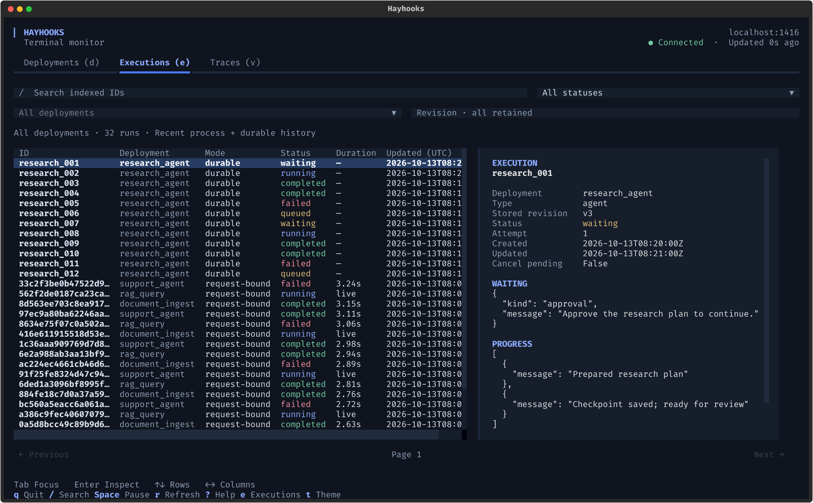
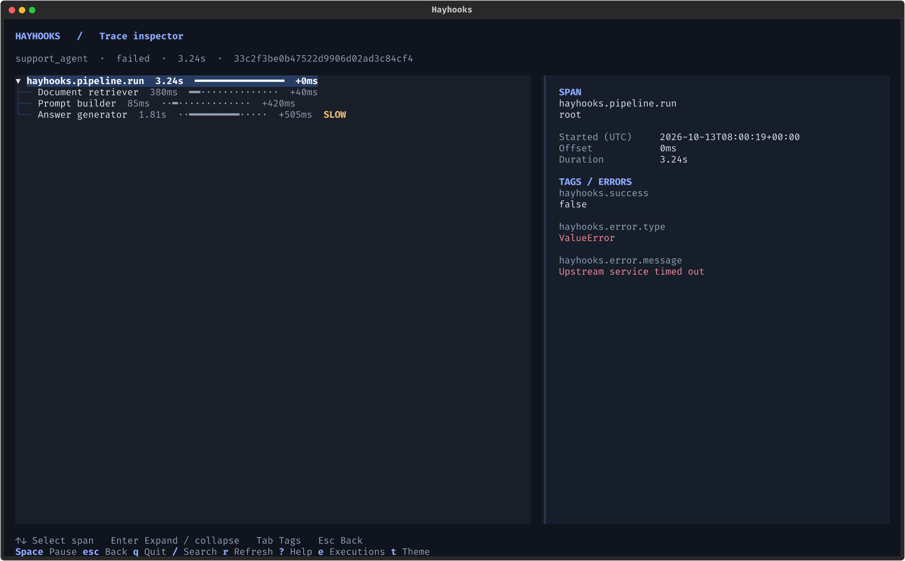

# Terminal dashboard

<span class="landing-eyebrow">Deployments · executions · traces</span>

## See what is running. Find where time goes.

The Hayhooks dashboard brings deployment health, ordinary and durable executions, and component traces into one terminal interface. Browse with the keyboard or mouse, filter the view, and open a run for the details.

<div class="dashboard-frame" markdown>



</div>

*Screenshots show the actual terminal UI with illustrative demo data.*

## Open your first dashboard

Start a local server:

```bash
pip install "hayhooks[tui]"
hayhooks run
```

In a second terminal, under the same OS account:

```bash
hayhooks dashboard
```

The server defaults to `http://localhost:1416`. Run one of your deployed pipelines, then press `e` to see its execution or `v` to inspect its trace. An empty server starts with an empty deployment list; follow the [quick start](../getting-started/quick-start.md) to deploy your first pipeline.

Local capture and durable indexing are enabled by default. On POSIX systems, a server bound to a literal loopback hostname and a client under the same OS account share a private operator credential automatically. Windows requires explicit credentials, as described below.

The UI uses the optional `tui` extra on Python 3.10–3.14. Server startup and ordinary CLI commands do not require Textual. Local inspection needs no browser, Node.js, Redis for ordinary runs, or external tracing backend.

## Three views, one workflow

=== "Deployments · d"

    See pipeline and agent metadata, execution mode, endpoint capabilities, and durable health. Search names or filter deployment types, then select a row for its description and process/store details.

    

    `Loaded` means registered. It does not mean that external dependencies were probed; MCP/A2A eligibility does not prove that a protocol server is running.

=== "Executions · e"

    See recent ordinary runs alongside durable execution history across deployments. Filter by deployment, ID, or state; use a revision filter for durable history. Select a durable execution for its attempt, waiting reason, progress, and error. Opening an ordinary run shows its trace.

    

    `[` and `]` browse durable pages. Ordinary runs appear on the first page only. Trace durations measure runtime; durable creation/update timestamps do not.

=== "Traces · v"

    Filter by entrypoint, operation kind, or state. Search traces and tags, sort newest or slowest, and press Enter to open the component tree. Each span shows its duration and offset; completed slow components are highlighted.

    

    Press `c` in the trace list to hide the current sample locally. This does not delete server traces.

## Keep your hands on the keyboard

| Key | Action |
| --- | --- |
| `d` / `e` / `v` | Deployments / Executions / Traces |
| ↑ / ↓ | Select a row or span |
| Enter / Esc | Open details / go back |
| `/` | Search the current view |
| Tab / Shift+Tab | Move between controls |
| Space / `r` | Pause / refresh now |
| `[` / `]` | Previous / next durable page |
| `t` / `?` | Switch theme / open help |
| `q` / Ctrl+C | Quit |

Typing into an input keeps shortcut letters as text. Wide terminals show details beside the list; narrow terminals open a separate detail screen. Polling defaults to two seconds, backs off after failures, and retains the last good snapshot with a stale indicator. Change the interval with `hayhooks dashboard --interval 5`.

## Connect to a remote server

Configure a shared operator token on the remote Hayhooks server before starting it:

```bash
export HAYHOOKS_TRACING_TOKEN="<operator-token>"
hayhooks run --host 0.0.0.0
```

In your local terminal, set the same token and use the server's reachable HTTPS URL:

```bash
export HAYHOOKS_DASHBOARD_TOKEN="<operator-token>"
hayhooks dashboard --url https://hayhooks.example.com
```

Use an HTTPS reverse proxy for the remote server. `--url` also supports a proxy path prefix, such as `https://example.com/hayhooks`. The client keeps TLS verification enabled; use `REQUESTS_CA_BUNDLE` for a private certificate authority. Keep credentials out of URLs.

The token grants process-wide trace inspection, including other users' operations. Durable execution access still respects the host's owner authorization. Existing authentication systems can use a [verified operator dependency](../reference/tracing.md#operator-authorization) and [owner/monitoring dependencies](../deployment/durable-operations.md#monitoring-authentication). Hayhooks does not require an API-key system; API-key headers are an optional integration for a custom host.

## Export a snapshot

```bash
# Server status and deployment metadata
hayhooks dashboard --once --json

# Also include local traces
hayhooks dashboard --once --json --traces

# Also include this deployment's durable execution page
hayhooks dashboard --once --json --pipeline research_agent
```

These commands work without Textual. Stdout contains JSON; errors go to stderr and return exit code 1. A degraded server returns its snapshot and also exits 1.

## Know the scope

- The dashboard performs GET requests only. It does not submit, resume, cancel, deploy, undeploy, or clear server traces.
- Ordinary executions and traces come from a bounded buffer in the responding process. Restarting or evicting that buffer removes the sample. Multiple workers and replicas have separate samples; use OTLP for persistent or fleet-wide trace history.
- Durable history comes from owner-scoped execution indexes in Memory or Redis. Retention and coverage follow the store and writing replicas; see [execution monitoring](../deployment/durable-operations.md#execution-monitoring).
- Standalone `hayhooks mcp run` and `hayhooks a2a run` servers capture protocol spans but do not expose the dashboard trace API. A dashboard connected to the main HTTP server cannot inspect those separate processes.
- Payload values are excluded by default. Disable the local trace API with `--without-tracing` and durable indexing/collection routes with `--without-monitoring` if needed.

Moving from the browser dashboard? Read the [migration guide](../reference/tracing.md#migration-from-the-browser-dashboard). For exporter setup, see [tracing and OpenTelemetry](../reference/tracing.md); for every option, see the [CLI reference](cli-commands.md#dashboard).
