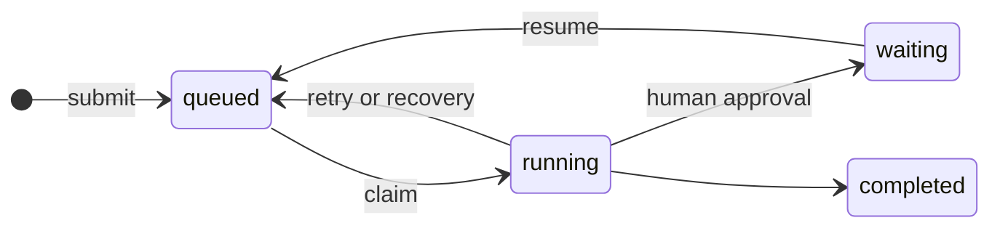

---
hide:
  - navigation
  - toc
---

<div class="landing-hero" markdown>
<div class="landing-copy" markdown>

<span class="landing-eyebrow">Haystack in production</span>

# Serve agents.<br>Inspect runs. {#serve-agentssee-every-run}

Serve REST APIs, OpenAI-compatible chat, MCP tools, and A2A agents. Keep work durable and inspect executions from your terminal.

<div class="landing-actions" markdown>

[Get started](getting-started/quick-start.md){ .md-button .md-button--primary }
[Explore the dashboard](features/terminal-dashboard.md){ .md-button }

</div>

</div>
<div class="landing-preview" markdown>
<div class="dashboard-frame" markdown>

[](assets/terminal-dashboard/overview-120x36.png)

</div>
<p class="dashboard-caption">Actual terminal UI with demo data. Select the image for full size.</p>
</div>
</div>

## Serve it where your users work.

| Interface | What it gives you |
| --- | --- |
| [REST APIs](concepts/pipeline-deployment.md) | Typed inputs, validation, OpenAPI docs, file uploads, and custom routes |
| [OpenAI-compatible endpoints](features/openai-compatibility.md) | Streaming chat completions and Responses API support |
| [MCP support](features/mcp-support.md) | Pipeline tools for Cursor, Claude Desktop, and other MCP clients |
| [A2A support](features/a2a-support.md) | Discoverable agent cards and agent-to-agent delegation |
| [Open WebUI](features/openwebui-integration.md) / [Chainlit](features/chainlit-integration.md) | Chat interfaces for deployed pipelines and agents |

<div class="landing-section" markdown>

## One place to understand a run.

Start with the health of a deployment. Follow its execution. Open the trace and find the component that took the time.

<div class="dashboard-path" markdown>

- **Deployments**<br>Pipeline and agent metadata, endpoint capabilities, and durable process health. Press `d`.
- **Executions**<br>Recent ordinary runs beside paginated durable history. Inspect state, attempts, progress, and waiting reasons. Press `e`.
- **Traces**<br>Filter activity, compare timing, and open an expandable component tree with a terminal waterfall. Press `v`.

</div>

=== "Start the server"

    ```bash
    pip install "hayhooks[tui]"
    hayhooks run
    ```

=== "Open the dashboard"

    On macOS or Linux, open a second terminal under the same OS account. For Windows or remote access, follow the [connection guide](features/terminal-dashboard.md#connect-to-a-remote-server):

    ```bash
    hayhooks dashboard
    ```

    Run a deployed pipeline, then press `e` for executions or `v` for traces.

The dashboard is read-only. Ordinary runs come from a bounded buffer in the responding process; durable history follows the execution store's retention. Standalone MCP and A2A servers have separate trace buffers that this dashboard cannot inspect.

[Dashboard guide](features/terminal-dashboard.md) · [Remote connections](features/terminal-dashboard.md#connect-to-a-remote-server) · [Tracing and OTLP](reference/tracing.md)

</div>

<div class="landing-section" markdown>

## Let the work survive the restart.

An agent researching for ten minutes. A pipeline waiting for approval. A deployment while a job is still running. Durable execution checkpoints work in Redis and resumes it from the last checkpoint on any replica.



[Durable execution](features/durable-execution.md){ .md-button }
[Operations guide](deployment/durable-operations.md){ .md-button }

</div>

[Installation options](getting-started/installation.md) · [Configuration](getting-started/configuration.md) · [Examples](examples/overview.md) · [GitHub](https://github.com/deepset-ai/hayhooks)
